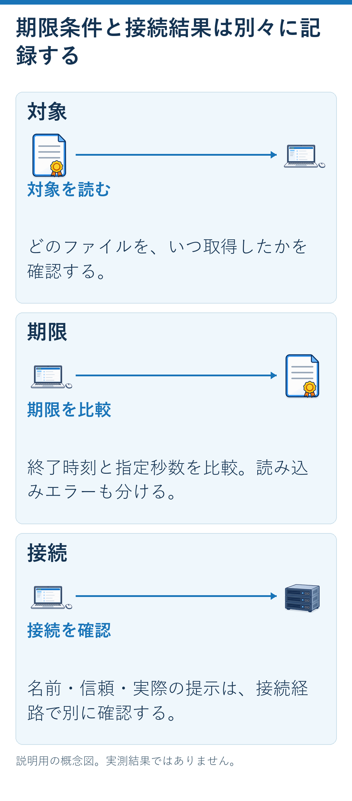

Certificateで要求した有効期間と、CAが実際に発行する期間は同じとは限りません。更新設計では、希望するdurationだけでなく、発行後のnotBeforeとnotAfterを入力にします。

## 絶対時間と割合

cert-managerの`renewBefore`は絶対時間、`renewBeforePercentage`は実際に発行された期間に対する割合から更新の余裕を計算します。[cert-manager — Certificate resource](https://cert-manager.io/docs/usage/certificate/)

例えば、実期間を30日、残す割合を30%と仮定すると、満了前の余裕は9日です。これは計算例であり、推奨値でも発行実績でもありません。実際の更新時刻はCertificateの状態と発行された証明書を確認します。

|設計入力|確認する理由|
|---|---|
|要求した期間|申請側の意図を残す|
|実際の期間|CA側の制約を反映する|
|更新に使える余裕|障害時の再試行と作業時間を確保する|
|配備に要する時間|発行後に必要な作業を含める|

## 比率だけで安全を決めない

期間の短い証明書では、同じ30%でも使える時間は短くなります。手動承認が一日必要な運用と、常時自動配備できる運用では、同じ設定をコピーする理由はありません。

まず、失敗を検知するまでの時間、担当者が着手するまでの時間、再発行と配備の所要時間を見積もります。その合計が余裕の中へ収まるかを確認します。未知の時間をゼロとして埋めないようにします。

## 変更時の比較

導入中のcert-managerとCRDの版を固定し、対応する項目を確認してから変更します。更新が頻発した場合は、希望期間、実期間、計算された時刻を同時に読みます。数値だけを調整するより、どの入力が想定から外れたかを先に説明できる設計が保守しやすくなります。

## 一次資料

- [cert-manager — Certificate resource](https://cert-manager.io/docs/usage/certificate/)

## 関連する図解と確認表

手順・図解・関連する確認表を追加で読みたい場合の補足です。

[ACME更新運用の工程と確認表](https://pki-channel.com/ja/articles/acme-renewal-deployment-design?utm_source=zenn.dev&utm_medium=referral&utm_campaign=owned_media&utm_content=own-b138-1)

関連する仕組み：期限条件と接続結果は別々に記録する

---

この記事の調査補助・文章・図解にはAIを使用しています。
