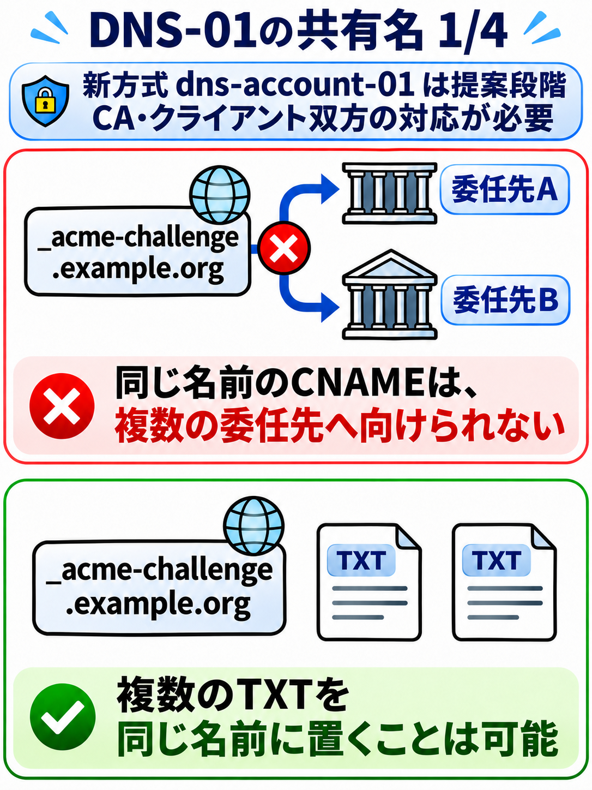
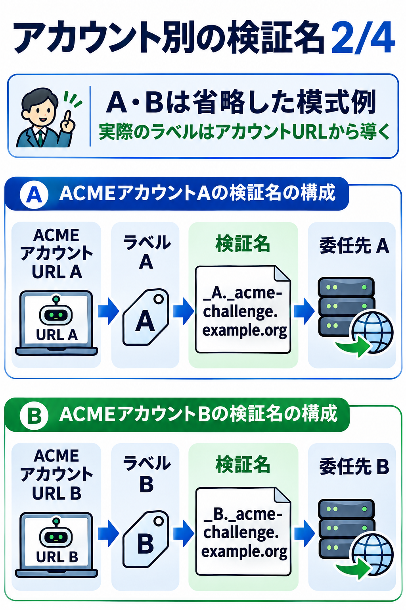
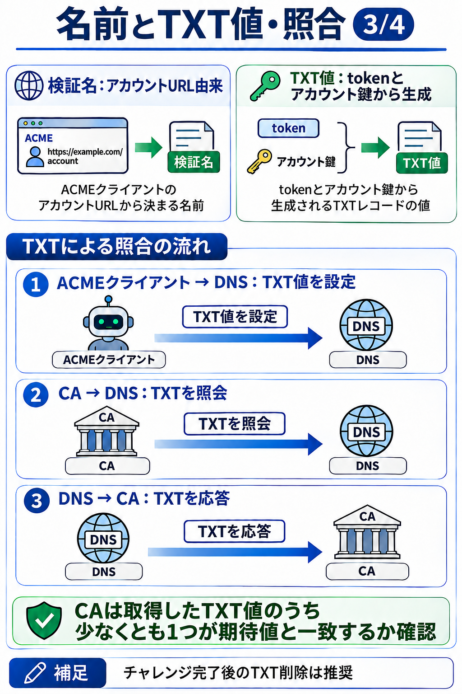
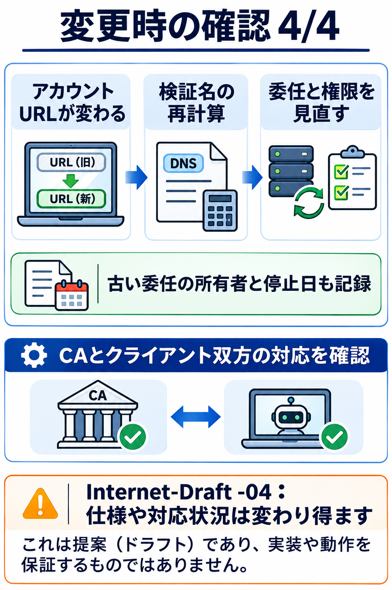
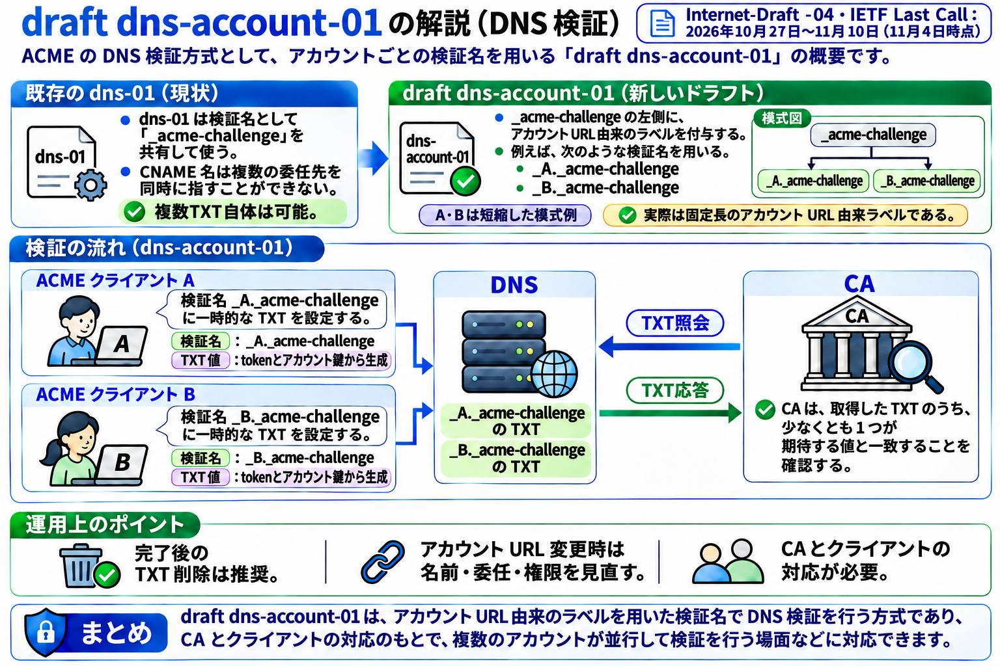

同じドメインの証明書を、別々のクラウドや運用チームが独立して更新したい。しかしDNS-01をCNAMEで委任する場合、同じ検証名に異なるCNAMEを同時には置けません。共通の委任先で複数のTXT値を扱う設計は可能ですが、管理者や更新権限の分離には別の設計が必要です。

この問題を扱う `draft-ietf-acme-dns-account-label-04` は、2026年10月27日にIETF Last Callへ進みました。コメント期限は11月10日。2026年11月5日時点では提案段階であり、RFC確定や、利用中のCA・クライアントでの対応を意味しません。

## 名前を分け、値はチャレンジごとに作る

通常のDNS-01では、検証対象`example.org`に対する検証名は`_acme-challenge.example.org`です。提案の`dns-account-01`では、ACMEアカウントURLから導いたラベルをさらに左側へ追加します。

従来のDNS-01でなぜTXTの書き込み権限が重要なのか、委任・伝播待ち・発行後の監視を先に押さえたい場合は、PKIちゃんねるの[DNS-01チャレンジ入門](https://pki-channel.com/ja/articles/acme-dns-01-guide)が参考になります。

```text
DNS-01:         _acme-challenge.example.org
DNS-account-01: _<アカウント由来ラベル>._acme-challenge.example.org
```

ドラフトの方法では、アカウントURLのSHA-256の先頭10バイトをBase32にして先頭に`_`を付けます。別アカウントなら、通常は別の検証名となり、それぞれを別の検証先へ委任できます。例は構造の説明であり、実在するDNSレコードや実行結果ではありません。

重要なのは、**名前とTXT値は別**という点です。TXT値はチャレンジのtokenとアカウント鍵から作るkey authorizationをSHA-256でハッシュし、base64url（パディングなし）で符号化した値です。名前がアカウントに結び付くからといって、同じTXT値を永久に置く方式ではありません。CAはその名前のTXT値を照合し、ドラフトではチャレンジ完了後にレコードを削除することを推奨しています。

## 図で見る検証名の分離

スマートフォンでも順番に読める4枚の図です。A・Bのラベルは説明用の模式例で、実際の値ではありません。









PC向けに全体をまとめた図も用意しました。



## 設計時に記録すること

|項目|運用上の確認|
|---|---|
|アカウントURL|ラベルの導出に使うため、変更時に既存DNS名へ影響する|
|権限|各チームが書けるDNS名と委任先を限定する|
|寿命|発行終了後のTXT削除と古い委任の棚卸しを設計|
|移行|新旧のアカウント・委任先・ロールバックを記録|
|互換性|CAとクライアントがこのチャレンジに対応しているか別々に確認|

ドラフトはアカウント識別子の安定性にも触れています。アカウントURLが変わればラベルを再計算し、DNS設定の見直しが必要になり得ます。鍵ローテーション自体はアカウントURLを変えなければラベルを変えずに行えるように設計されています。

委任先が分かれることは権限管理を簡単にする可能性がありますが、不要になった委任が自動的に安全になるわけではありません。停止日と所有者も含めて台帳に残しましょう。たとえばDNS API資格情報をどこまで絞れるかは事業者によって異なります。[Cloudflare DNSでのDNS-01設定例](https://pki-channel.com/ja/articles/acme-cloudflare-dns-recipe)では、対象ゾーンの限定と資格情報ファイルの保護を整理しています。これは従来のDNS-01の手順案で、実ゾーンでの試験は未実施です。今回の`dns-account-01`対応例を示すものではありません。

## 一次資料

- [IETF：dns-account-01案 -04](https://www.ietf.org/archive/id/draft-ietf-acme-dns-account-label-04.html)
- [IETF Datatracker：審査履歴とLast Call期限](https://datatracker.ietf.org/doc/draft-ietf-acme-dns-account-label/history/)
- [RFC 8555：ACME DNS-01](https://www.rfc-editor.org/rfc/rfc8555.html#section-8.4)

---

この記事は、文章・図解の作成にAIを利用し、IETFの一次資料と照合しました。実際のCAやクライアントでの動作検証は行っていません。

