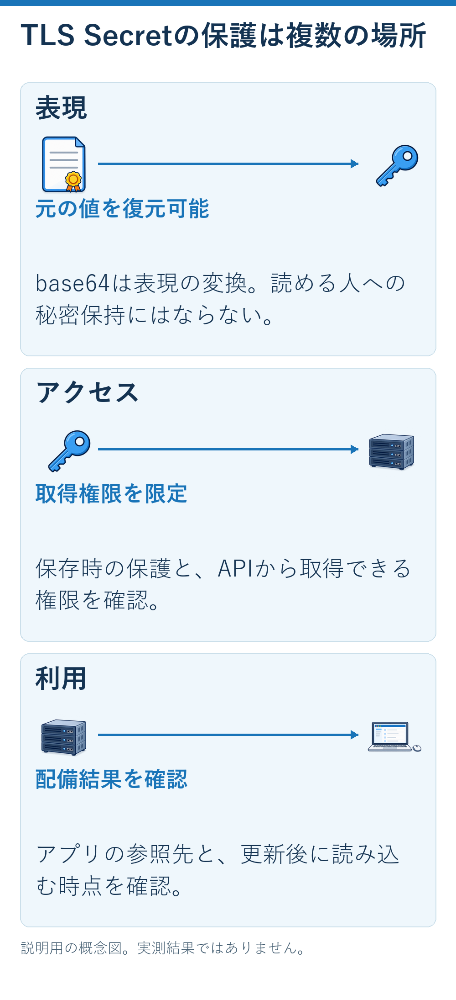

TLS SecretのYAMLには長い英数字が並びます。読みにくいため暗号化された値のように見えますが、base64はデータの表現を変える方法です。Secretという名前と、誰が中身を取得できるかを分けて考えます。

説明用の概念図。実測結果ではありません。

## tls.crtとtls.keyの役割

`kubernetes.io/tls`のSecretは、通常`tls.crt`と`tls.key`を持ちます。証明書と対応する秘密鍵です。APIの形式確認があることと、組織が意図した証明書が正しく配備されたことは同じではありません。

対象名、期限、鍵の対応、利用するIngressやアプリの参照先を確認します。

## base64はアクセス制御の代わりにならない

`data`の値をbase64にしても、読める人が元の内容を得ることを防げません。`stringData`を使うかどうかも、保護の強さを決める本質ではありません。

本物のSecretをGit、チャット、障害チケットへ貼り付けないでください。「文字が読めないから匿名化済み」とは扱えません。

## 保管・API権限・実行時を点検する

保存時の暗号化、APIを通じてSecretを取得する権限、Podへ渡した後のファイル権限やアプリの動作を、それぞれ確認します。ひとつ設定しただけで全経路が保護されると考えないことが大切です。

診断で値そのものが不要なら、名前、型、参照関係、更新時刻などのメタデータから始めます。

## 更新の到着と利用を分ける

Secretが更新されても、利用するアプリが新しい内容をいつ読み込むかは実装や渡し方に依存します。保存できた時刻と、接続先で新しい証明書を確認した時刻を分けて記録します。

チェック表は「誰が取得できるか／どこに保存されるか／誰が参照するか／いつ再読み込みするか」。Secretの形式から、実際の鍵の扱いへ視点を広げるための四問です。

## 一次資料

- [Kubernetes: Secrets](https://kubernetes.io/docs/concepts/configuration/secret/)

## もう少し詳しく知りたい方へ

本文で扱った仕組みや運用を、図解や関連する確認項目まで掘り下げる資料です。

- [GitOpsで進める証明書運用](https://pki-channel.com/ja/articles/gitops-certificates?utm_source=zenn.dev&utm_medium=referral&utm_campaign=owned_media&utm_content=own-b078-1)
- [ACME更新運用：発行・配置・reload・配信確認](https://pki-channel.com/ja/articles/acme-renewal-deployment-design?utm_source=zenn.dev&utm_medium=referral&utm_campaign=owned_media&utm_content=own-b078-2)

---

資料確認・執筆・図解制作にAIを使用しています。例や確認表は説明用で、実機試験の結果ではありません。
